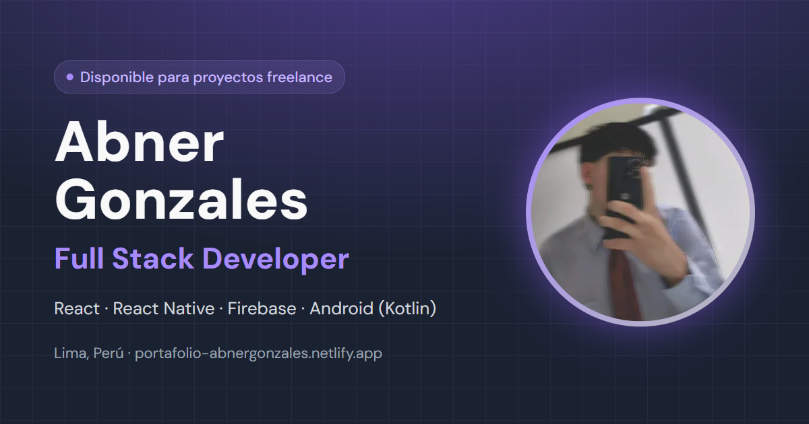

<div align="center">



# Abner Gonzales — Portafolio

**Full Stack Developer · React · Firebase · Android**

[](https://abnergonzales.dev/)
[](https://www.linkedin.com/in/abnergonzales7)
[](https://github.com/AbnerGA7)

</div>

---

## Sobre el proyecto

Portafolio personal construido con **Astro + React + Tailwind CSS v4**: sitio estático, rápido y bilingüe, con modo claro/oscuro y **una página por sección** — el menú lleva a subpáginas reales en lugar de hacer scroll en una sola página.

## Características

- 🧭 **Multipágina** — cada sección tiene su propia URL, migas de pan y un enlace a la página siguiente
- 🗃️ **Ficha por proyecto** — `/proyectos/<id>/` con galería de capturas, stack, estado y navegación anterior/siguiente
- 🌍 **Bilingüe (ES / EN)** — el selector de idioma conserva la página en la que estás (`/proyectos/` ⇄ `/en/projects/`)
- 🌗 **Modo claro / oscuro** — respeta la preferencia del sistema y se recuerda entre visitas, sin parpadeo al cargar
- ⚡ **Transiciones entre páginas** con View Transitions de Astro
- 🗂️ **Proyectos con filtros** por categoría (el filtro queda en la URL: `?cat=mobile`)
- 📬 **Formulario de contacto** funcional vía FormSubmit, además de WhatsApp, correo, LinkedIn, GitHub, Instagram y Facebook
- 🔎 **SEO** — Open Graph, Twitter Cards, `hreflang`, URL canónica y datos estructurados (Schema.org `Person`)
- ♿ **Accesibilidad** — foco visible con teclado, etiquetas ARIA y soporte para `prefers-reduced-motion`
- 📱 **Responsive** — diseñado para móvil, tablet y escritorio

## Páginas

| Página | Ruta (ES / EN) | Contenido |
|---|---|---|
| **Inicio** | `/` · `/en/` | Presentación, cifras, proyectos destacados y accesos a cada sección |
| **Proyectos** | `/proyectos/` · `/en/projects/` | Todos los proyectos con filtros por categoría |
| **Ficha de proyecto** | `/proyectos/<id>/` · `/en/projects/<id>/` | Resumen, galería, stack, estado y enlaces |
| **Experiencia** | `/experiencia/` · `/en/experience/` | Línea de tiempo de trabajo, freelance y formación |
| **Habilidades** | `/habilidades/` · `/en/skills/` | Tecnologías agrupadas por área |
| **Certificaciones** | `/certificaciones/` · `/en/certifications/` | Diplomas y constancias en PDF |
| **Sobre mí** | `/sobre-mi/` · `/en/about/` | Perfil, recorrido y CV |
| **Contacto** | `/contacto/` · `/en/contact/` | Canales directos y formulario |

## Stack


## Estructura

```bash
src/
├── assets/       # Foto de perfil y capturas de proyectos
├── components/
│   ├── layout/   # Header, footer, selectores de tema e idioma
│   ├── ui/       # Iconos, cabecera de página y "página siguiente"
│   ├── cards/    # Tarjeta de proyecto
│   └── */data/   # Contenido de cada sección (proyectos, skills, experiencia...)
├── data/         # Enlaces de contacto
├── i18n/         # Textos en español e inglés (ui.ts) y utilidades
├── layouts/      # Layout base con SEO y transiciones
├── lib/          # Mapa de rutas ES/EN y helpers de proyectos
├── pages/        # Rutas en español (raíz) y en inglés (/en)
├── views/        # Una vista por página, compartida entre idiomas
├── styles/       # Tema (tokens claro/oscuro) y fuentes
└── types/        # Interfaces de TypeScript
```

## Instalación local

Requiere **Node.js 22.19+**.

```bash
git clone https://github.com/AbnerGA7/Portafolio.git
cd Portafolio
npm install
npm run dev
```

Abre [http://localhost:4321](http://localhost:4321)

| Comando | Acción |
|---|---|
| `npm run dev` | Servidor de desarrollo |
| `npm run build` | Genera el sitio estático en `dist/` |
| `npm run preview` | Sirve la build localmente |
| `npm run check` | Verificación de tipos con `astro check` |

## Personalización

- **Textos (ES/EN):** `src/i18n/ui.ts`
- **Proyectos:** `src/components/projects/data/projectsData.ts` (capturas en `src/assets/projects/`)
- **Habilidades:** `src/components/skills/data/techSkillsData.tsx`
- **Experiencia:** `src/components/experience/data/experienceData.ts`
- **Colores del tema:** variables en `src/styles/global.css`

## Despliegue

Se despliega en **Vercel** automáticamente con cada push a la rama `main` (`vercel.json`: `npm run build` → `dist/`).

## Contacto

<div align="center">

[](mailto:abner.gonzales.work@gmail.com)
[](https://wa.me/51904100380)
[](https://www.instagram.com/abner_gonzales7)
[](https://www.facebook.com/abnerGonzalesA.7)

</div>

## Licencia

Distribuido bajo [Licencia MIT](LICENSE).

---

<div align="center">
Hecho con ❤️ por <strong>Abner Gonzales</strong>
</div>
